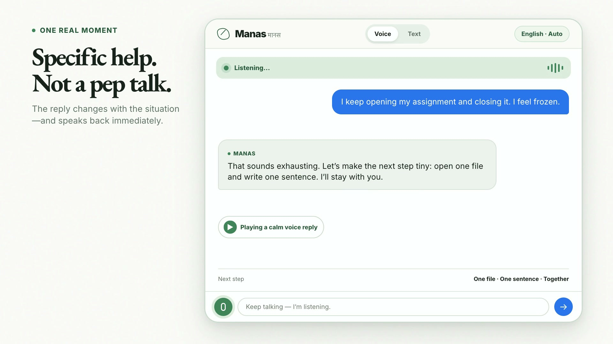

# Manas · मानस

> A calmer first step, in your language.

Manas is a multilingual, voice-first mental-health intake and counsellor-handoff prototype built with Sarvam AI. It listens naturally, replies aloud with one grounded next step, tracks safety signals silently, and keeps a real human one tap away.

Built by **Umang Pandey and Faheem** for **Sarvam Campus ’26 · SRM**.

[](https://manas-ai-sarvam.netlify.app)
[](https://www.sarvam.ai/)

## Watch the 18-second launch film

[](brag-output/brag.mp4)

**[▶ Watch with sound](brag-output/brag.mp4)**

## Why Manas

Most mental-health bots try to replace the counsellor. **Manas prepares the counsellor.**

People often delay asking for help because the first conversation is difficult, support is not available in their language, or they do not want to repeat painful context. Manas makes that first step smaller while preserving a clear path to trained human support.

## What it does

- Accepts natural speech through a clear voice mode.
- Understands English, Hindi, Tamil, Bengali, and other supported Indian languages.
- Generates short, situation-specific replies instead of generic encouragement.
- Speaks every reply aloud immediately with a calm Sarvam voice.
- Suggests one achievable action and one useful choice-based question.
- Tracks distress and crisis indicators without exposing clinical-looking scores to the user.
- Switches urgent conversations to deterministic safety copy.
- Keeps human support and the Tele-MANAS `14416` option visible.
- Produces a counsellor-ready handoff brief with the relevant context.

## The four-agent system

| Agent | Role |
|---|---|
| **Sunna · सुनना** | Warm, specific user-facing response and one small next step. |
| **Samajhna · समझना** | Silent risk-signal extraction and conversation context. |
| **Nirdeshak · निर्देशक** | Deterministic routing, safety mode, and escalation lock. |
| **Setu · सेतु** | Structured brief for a counsellor or trained human. |

Critical safety paths are deterministic for reliability. Manas does not diagnose, replace counsellors, or claim that emergency services were contacted.

## Sarvam-powered voice flow

```text
User speaks
    │
    ▼
Saaras v3 · speech-to-text
    │
    ├── Mayura v1 · English safety-analysis copy when required
    │
    ▼
Manas deterministic triage and routing
    │
    ├── normal path ──► Sarvam 105B Conversations · contextual Sunna reply
    │
    └── urgent path ──► deterministic safety response and human handoff
    │
    ▼
Mayura v1 · selected-language translation
    │
    ▼
Bulbul v3 · immediate spoken reply
```

The Sarvam API key stays inside a Netlify Function and is never shipped to the browser.

## Five-minute judge demo

For a broader project story, including the build narrative, website walkthrough, stack explanation, safety boundaries, and positioning beyond the competition, see the [Manas project storyboard](STORYBOARD.md).

1. Open the **[live app](https://manas-ai-sarvam.netlify.app)** and choose **Voice**.
2. Say: “I keep opening my assignment and closing it. I feel frozen.”
3. Show the specific next action and the automatic spoken reply.
4. Switch to **हिन्दी**, **தமிழ்**, or **বাংলা** and continue naturally.
5. Open **How Manas is helping** to show the four-agent flow.
6. Use the built-in safety demo to show deterministic escalation, human support, and the Setu handoff packet.

For the full escalation path, send these messages one at a time:

```text
I have been feeling low and tired lately.
I have no one to share with.
I feel hopeless and worthless.
I want to kill myself.
```

Expected result: risk signals accumulate, Manas recommends human support, critical risk locks escalation, and Setu prepares the handoff brief.

## Run locally

Requirements: Node.js 18+ and a Sarvam API key.

```bash
npm install
cp .env.example .env
```

Add your key locally:

```env
SARVAM_API_KEY=your_key_here
```

Start the app and its secure Netlify Function:

```bash
npm run dev:voice
```

Open the local Netlify URL, allow microphone access, and tap the voice button. Recordings are capped at 28 seconds to keep the demo responsive.

> Never commit `.env` or paste a real API key into source code. If a key has been shared publicly, revoke and replace it immediately.

## Build and deploy

```bash
npm run build
```

Netlify configuration:

| Setting | Value |
|---|---|
| Build command | `npm run build` |
| Publish directory | `dist` |
| Function directory | `netlify/functions` |
| Environment variable | `SARVAM_API_KEY` |

## Project structure

```text
src/
  agents/                  # Sunna, Samajhna, Nirdeshak, Setu
  components/              # Onboarding, conversation, dashboard, handoff UI
  services/sarvamVoice.js  # STT, translation, contextual reply, TTS
  triage/triageEngine.js   # Deterministic safety and routing logic
  styles/                  # Responsive product UI
netlify/functions/
  sarvam.cjs               # Server-side Sarvam API proxy
brag-output/
  brag.mp4                 # Launch film
  brag.jpg                 # Poster and social thumbnail
```

## Safety boundary

Manas is a hackathon prototype—not a diagnosis, medical advice, emergency service, or replacement for professional care. In a real deployment, escalation must follow the operating organisation’s trained crisis-support protocol and local requirements.

## Team

**Umang Pandey × Faheem** · Sarvam Campus ’26 · SRM

Try it: **[manas-ai-sarvam.netlify.app](https://manas-ai-sarvam.netlify.app)**
